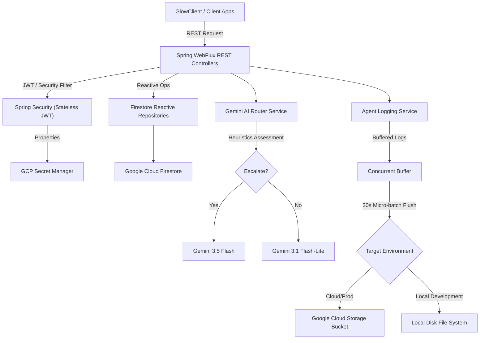

# BLS Scheduler Backend API

A premium, reactive Spring Boot backend application designed to handle Basic Life Support (BLS) training and class scheduling. Built with **Java 21**, **Spring Boot 3.2.x**, and fully integrated with the **Google Cloud Platform (GCP)** stack, this service provides high-performance, non-blocking APIs for managing companies, user memberships, scheduling, and structured telemetry logs.

---

## 🌟 Key Features

* **Fully Reactive Architecture**: Built using Spring WebFlux and Project Reactor. Employs `FirestoreReactiveRepository` for non-blocking, asynchronous operations against GCP Firestore.
* **Hierarchical Firestore Data Model**: Leverages Firestore's subcollection capabilities to store and query deeply nested relationships:
  $$\text{companies} \rightarrow \text{dates} \rightarrow \text{times} \rightarrow \text{classslots}$$
* **Intelligent Gemini AI Router**: The `GeminiRoutingService` dynamically evaluates developer/user tasks. It routes low-complexity prompts to **Gemini 3.1 Flash-Lite** and escalates to **Gemini 3.5 Flash** when complex logic, coding blocks, or critical security reviews are detected.
* **Structured Telemetry & Buffering**: Includes an `AgentLoggingService` that buffers structured JSON telemetry. Buffered logs are micro-batched and flushed to **Google Cloud Storage (GCS)** every 30 seconds (ideal for direct loading into BigQuery) with an automated local disk fallback.
* **Self-Contained E2E Test Suite**: Exposes a programmatically driven integration test endpoint (`GET /api/test/run`) which verifies JWT authentication flows, validation constraints, and E2E Firestore document generation, returning a premium visual report.
* **Secure Secret Manager Integration**: Dynamically imports administrative credentials (`super-id`, `super-user-password`, `jwt-key`) securely at runtime directly from **GCP Secret Manager**.
* **GlowClient REST Dashboard**: Hosts a beautiful, browser-based API testing client directly at the server root (`http://localhost:8080/`), preloaded with BLS Scheduler API presets.

---

## 🏗️ Architectural Topology

The following diagram outlines the system architecture and data flows:



---

## ⚙️ Configuration Profiles

The application is built around three preconfigured profiles defined in [application.yaml](file:///c:/workspace/intellijProjects/blsscheduler/src/main/resources/application.yaml):

1. **`local`**: Designed for standalone developer environments. It routes all Firestore connections to a local emulator (`localhost:8089`) and falls back to saving buffered micro-batch logs to local disk under `logs/micro-batches`.
2. **`dev`**: Integrates directly with GCP test cloud resources using the `bls-sched-db-test` database ID in project `bls-trainingscheduler`.
3. **`prod`**: Production-ready deployment. Targets the production Firestore database `bls-sched-db-prod` and tightens CORS allowed origins to production endpoints.

---

## 🚀 Getting Started

### Prerequisites
* **Java Development Kit (JDK) 21**
* **Apache Maven 3.9+**
* **GCP SDK (gcloud CLI)** authenticated (for `dev`/`prod` profiles)
* **Firestore Local Emulator** installed and running (for `local` profile)

### Running the Application

#### A. Running Locally with Firestore Emulator
1. Start the Firestore emulator:
   ```bash
   gcloud beta emulators firestore start --host-port=localhost:8089
   ```
2. Run the Spring Boot application under the `local` active profile:
   ```bash
   mvnw spring-boot:run -Dspring-boot.run.profiles=local
   ```

#### B. Building and Running with Docker
A optimized multi-stage [Dockerfile](file:///c:/workspace/intellijProjects/blsscheduler/Dockerfile) is available in the root folder.
1. Build the lightweight production image:
   ```bash
   docker build -t bls-scheduler-backend .
   ```
2. Run the container (ensure GCP environment variables are passed):
   ```bash
   docker run -p 8080:8080 -e PORT=8080 -e SPRING_PROFILES_ACTIVE=prod bls-scheduler-backend
   ```

---

## 🔌 API Documentation Reference

Authentication token returned on successful login must be included in the header of restricted endpoints as:
`Authorization: Bearer <jwt-token>`

### 1. Authentication & Onboarding
* **`POST /api/register`**: Onboard a new company and their administrator user account in a single transaction.
  * **Payload**:
    ```json
    {
      "companyName": "Safety Training Partners",
      "purpose": "First-aid & BLS certification provider",
      "fullname": "John Doe",
      "emailAddress": "admin@safetypartners.com",
      "password": "SecurePassword123"
    }
    ```
* **`POST /api/authenticate`**: Logs in a user using their username, password, and `companyId`.
  * **Payload**:
    ```json
    {
      "username": "admin@safetypartners.com",
      "password": "SecurePassword123",
      "companyId": "generated-company-uuid"
    }
    ```
* **`POST /api/authenticate-by-company-name`**: Convenience login which automatically resolves `companyName` to `companyId` internally.

### 2. Company Management
* **`GET /api/companies`**: Retrieves all registered companies (including name, purpose, and approval status).
* **`PUT /api/companies/{companyId}/approval`**: Updates approval status of a company (e.g., to active status `"Yes"`). *(Admin-only control)*

### 3. User Membership CRUD
* **`GET /api/companies/{companyId}/users`**: Retrieve all user records for a specific company.
* **`POST /api/companies/{companyId}/users`**: Add a new user under a company.
* **`PUT /api/companies/{companyId}/users/{userId}`**: Update an existing company user.
* **`DELETE /api/companies/{companyId}/users/{userId}`**: Remove a user from a company.

### 4. Class & Schedule Management
* **`POST /api/companies/{companyId}/dates`**: Schedule a date, time slot, and pre-populate an array of blank class slots (rejections apply if requested slots are $<1$ or $>30$). *(Requires 'user' authorization)*
  * **Payload**:
    ```json
    {
      "dateValue": "2026-07-15",
      "startTimeValue": "09:00 AM",
      "endTimeValue": "11:00 AM",
      "numberOfSSlots": 15
    }
    ```
* **`GET /api/companies/{companyId}/dates`**: List all scheduled class dates for a company.
* **`GET /api/companies/{companyId}/dates/{dateId}/times`**: Retrieve all scheduled hours for a date.
* **`GET /api/companies/{companyId}/dates/{dateId}/times/{timeId}/classslots`**: View individual seating/slots.
* **`PUT /api/companies/{companyId}/dates/{dateId}/times/{timeId}/classslots/{slotId}`**: Book or modify details for a slot.

### 5. AI Workflows & Intelligence
* **`POST /api/agent/route`**: Evaluate tasks through the automated LLM Router and observe execution metrics.
  * **Payload**:
    ```json
    {
      "prompt": "Evaluate security filters and optimize regular expression rules for the incoming stream."
    }
    ```

### 6. Logging & Diagnostics
* **`POST /api/agent/log`**: Submit structured agent entries to the micro-batch memory buffer.
* **`POST /api/agent/flush`**: Manually trigger immediate log flushing to storage.
* **`GET /api/test/run`**: Run the self-contained verification suite verifying integrity of Firestore, JWTs, and bounds validations.
